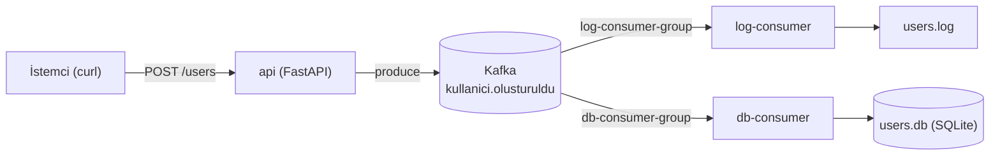

# Event-Driven Kullanıcı Kayıt Sistemi

FastAPI, Apache Kafka, SQLite ve Docker Compose ile geliştirilmiş, olay güdümlü (event-driven) bir kullanıcı kayıt sistemi.

## Mimari



`api`, yeni kullanıcıyı `kullanici.olusturuldu` topic'ine bir olay olarak yayınlar. İki consumer **farklı `group.id`** değerleriyle çalıştığı için her biri aynı mesajı bağımsız olarak okur (pub/sub fan-out).

| Servis | Görevi |
|---|---|
| `zookeeper` | Kafka koordinasyonu (`confluentinc/cp-zookeeper:7.5.0`) |
| `kafka` | Mesaj broker'ı (`confluentinc/cp-kafka:7.5.0`) |
| `api` | `POST /users` ile olayı Kafka'ya yayınlayan FastAPI producer |
| `log-consumer` | Her olayı tarih damgasıyla (UTC+3) `users.log` dosyasına ve konsola yazar |
| `db-consumer` | Her kullanıcıyı SQLite `users` tablosuna kaydeder |

## Klasör Yapısı

```text
.
├── docker-compose.yml
├── api/
│   ├── Dockerfile
│   ├── requirements.txt
│   └── main.py
├── log-consumer/
│   ├── Dockerfile
│   ├── requirements.txt
│   └── consumer.py
└── db-consumer/
    ├── Dockerfile
    ├── requirements.txt
    └── consumer.py
```

## Mühendislik Kararları

- **Kafka ağ iletişimi:** `KAFKA_ADVERTISED_LISTENERS` Docker iç ağıyla uyumlu `PLAINTEXT://kafka:9092` olarak ayarlıdır; servislere `KAFKA_BOOTSTRAP=kafka:9092` geçilir.
- **Fan-out izolasyonu:** `log-consumer-group` ve `db-consumer-group` ayrı consumer grupları olduğundan her mesaj iki servise de ulaşır.
- **Anlık loglar:** Tüm Dockerfile'larda `ENV PYTHONUNBUFFERED=1` tanımlıdır ve `print(..., flush=True)` kullanılır.
- **Hata toleransı:** Servisler `restart: unless-stopped` ile çalışır; consumer'lar Kafka hazır olana kadar artan aralıklarla yeniden bağlanmayı dener, bozuk mesajlarda çökmez.
- **FastAPI ve threading:** `confluent_kafka` senkron olduğu için endpoint `async def` değil `def` olarak tanımlıdır; FastAPI bunu threadpool'da çalıştırır.
- **Idempotency:** Kafka at-least-once çalıştığı için `db-consumer` `INSERT OR IGNORE` kullanır ve offset'i ancak kayıt yazıldıktan sonra commit eder.

## Çalıştırma

Gereksinim: Docker Desktop (Docker Compose v2).

```bash
docker compose up --build -d
docker compose ps
```

Consumer loglarında `Kafka'ya bağlanıldı` satırı görünene kadar 10–20 saniye bekleyin.

## Test

**Kullanıcı oluşturma**

```bash
curl -i -X POST http://localhost:8000/users \
  -H "Content-Type: application/json" \
  -d '{"ad":"Sancar","email":"sancar@test.com"}'
```

Windows PowerShell 5.1:

```powershell
curl.exe -i -X POST http://localhost:8000/users -H "Content-Type: application/json" -d '{\"ad\":\"Sancar\",\"email\":\"sancar@test.com\"}'
```

Beklenen yanıt: `HTTP/1.1 201 Created`

```json
{"id":"<uuid>","ad":"Sancar","email":"sancar@test.com","event":"KULLANICI_OLUSTURULDU"}
```

**Log consumer**

```bash
docker compose logs log-consumer
docker compose exec log-consumer cat /app/users.log
```

**DB consumer (SQLite)**

```bash
docker compose exec db-consumer sqlite3 -header -column /app/users.db "SELECT * FROM users;"
```

**Tüm akışı canlı izleme**

```bash
docker compose logs -f api log-consumer db-consumer
```

## Kapatma

```bash
docker compose down
```

> `users.log` ve `users.db` konteyner içinde tutulur (volume tanımlı değildir); `docker compose down` sonrasında silinirler.
